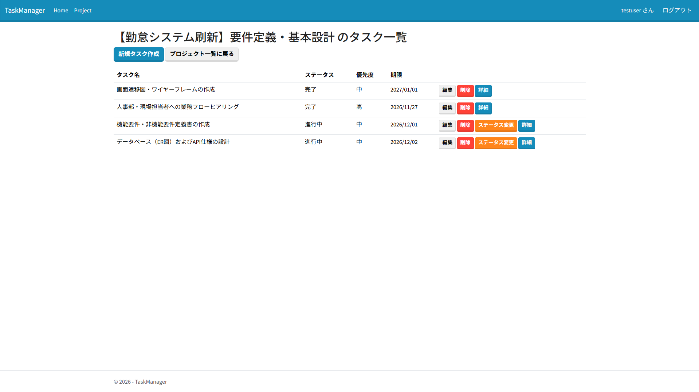
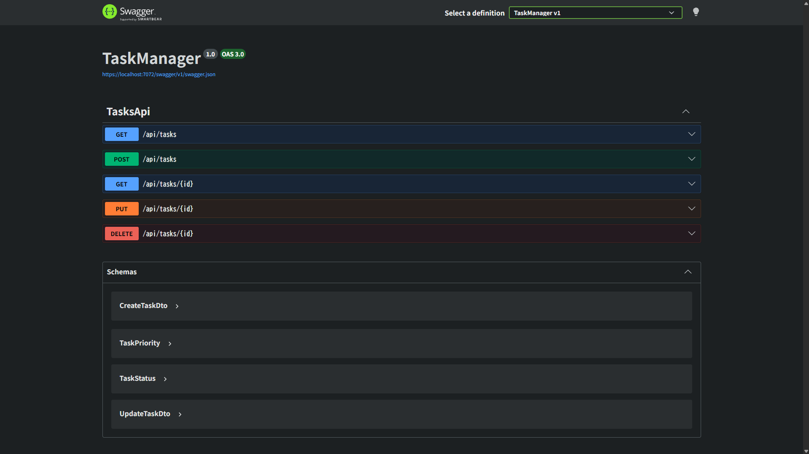
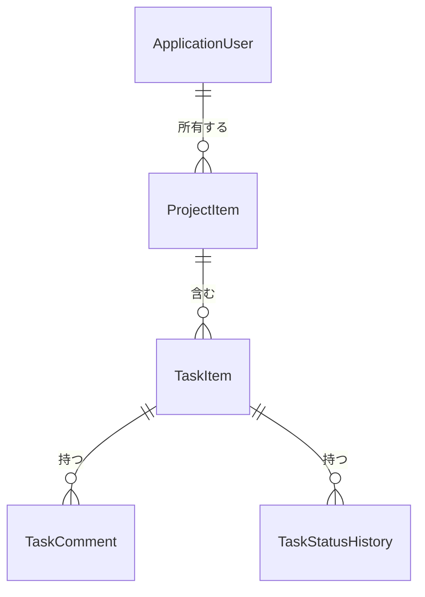

# TaskManager

ASP.NET Core MVC と PostgreSQL で作った、**個人用のタスク管理 Web アプリ**です。
C# による業務系・Web 系開発の基礎を学ぶために、認証、DB 設計、CRUD、外部 API 連携、Web API 化までを一通り実装した**学習用ポートフォリオ**です。

プロジェクトの下に複数のタスクをぶら下げ、ステータスや期限を管理できます。ユーザーごとにデータを分離しているので、自分のデータだけを閲覧・操作できます。

<!-- TODO: 画面のスクリーンショットを docs/images に置いて、下の表を有効にする -->

## １．画面イメージ

| ログイン | プロジェクト一覧 |
|---|---|
|  |  |

| タスク一覧 | タスク詳細(コメント・履歴・祝日表示) |
|---|---|
|  |  |

| Swagger(Web API) |
|---|
|  |

---

## ２．主な機能

| 分類 | 内容 |
|---|---|
| 認証 | ユーザー登録、ログイン、ログアウト(ASP.NET Core Identity、Cookie 認証) |
| プロジェクト管理 | 一覧、作成、編集、削除(削除時は紐づくタスクもまとめて削除) |
| タスク管理 | 一覧、作成、編集、削除、詳細表示 |
| ステータス変更 | 一覧画面のボタンで、未着手 → 進行中 → 完了と 1 クリックで進める |
| コメント | タスクごとのコメント投稿・一覧表示 |
| ステータス履歴 | ステータスが変わるたびに、変更前後と日時を自動記録・表示 |
| 祝日表示 | 外部 API から祝日を取得して DB に保存し、期限が祝日のタスクに祝日名を表示 |
| Web API | タスクの CRUD を REST API として提供(Swagger で確認可能) |

## ３．使用技術

- C# / .NET 10(ASP.NET Core MVC)
- Entity Framework Core 10 / Npgsql(PostgreSQL)
- ASP.NET Core Identity(Cookie 認証)
- Razor / Tag Helper / Bootstrap(Bootswatch の Lumen テーマ)
- Swashbuckle(Swagger UI)
- 外部 API:[Holidays JP API](https://holidays-jp.github.io/)(日本の祝日)

---

## ４．動作環境と起動方法

### 必要なもの

- .NET 10 SDK
- PostgreSQL(動作確認は PostgreSQL 18)
- Visual Studio 2026(または `dotnet` CLI)
- 祝日の取得のため、起動時にインターネット接続が必要です(取得できなくてもアプリは起動します)

### 手順

1. リポジトリを取得し、`TaskManager.csproj` があるフォルダへ移動します。

   ```bash
   git clone https://github.com/kmz-0125/TaskManager.git
   cd TaskManager
   ```

2. DB の接続文字列を **User Secrets** に登録します(パスワードをリポジトリに含めないため)。

   ```bash
   dotnet user-secrets set "ConnectionStrings:DefaultConnection" "Host=localhost;Port=5432;Database=TaskManagerDb;Username=postgres;Password=<自分のパスワード>"
   ```

3. DB を作成します(マイグレーションを適用)。

   ```bash
   dotnet tool install --global dotnet-ef   # 未インストールの場合のみ
   dotnet ef database update
   ```

   Visual Studio の場合は、パッケージマネージャーコンソールで `Update-Database` でも構いません。

4. アプリを起動します。

   ```bash
   dotnet run
   ```

   起動後、表示された URL にアクセスし、「新規登録」からユーザーを作成してください。

### Swagger(Web API)の確認

開発環境(`Development`)でのみ有効です。

1. 先に、画面からログインします(API は Cookie 認証のため、ログイン済みのブラウザから呼び出します)。
2. 同じブラウザで `/swagger` を開きます。
3. 未ログインのまま API を呼ぶと、ログイン画面へのリダイレクトではなく `401` が返ります。

---

## ５．Web API

認証済み(ログイン済み)のユーザー自身のタスクだけを対象とします。

| メソッド | パス | 概要 | 主なレスポンス |
|---|---|---|---|
| GET | `/api/tasks` | 自分の全タスクを取得 | 200 |
| GET | `/api/tasks/{id}` | タスクを 1 件取得 | 200 / 404 |
| POST | `/api/tasks` | タスクを作成 | 200 / 400 / 404 |
| PUT | `/api/tasks/{id}` | タスクを更新(送った内容で置き換え) | 200 / 400 / 404 |
| DELETE | `/api/tasks/{id}` | タスクを削除 | 204 / 404 |

リクエスト例(`POST /api/tasks`):

```json
{
  "projectId": 1,
  "title": "資料を作成する",
  "description": "概要をまとめる",
  "status": "NotStarted",
  "priority": "Medium",
  "dueDate": "2026-10-01"
}
```

`status` は `NotStarted` / `InProgress` / `Completed`、`priority` は `Low` / `Medium` / `High` を文字列で指定します。

---

## ６．設計上の工夫

### 1. 他人のデータを操作させない(所有者チェック)
- 1 件を取得する処理は、「ID が一致」かつ「所有者が自分」を 1 つのクエリで条件にしています。
- タスクはプロジェクト経由で所有者を判定します(`t.ProjectItem.UserId == userId`)。
- 表示(GET)だけでなく、更新・削除(POST)でも毎回所有者チェックをやり直しています。
- 所有者の ID はフォームから受け取らず、必ずログイン情報(Claim)から取得します。

### 2. Model と画面(ViewModel)・API(DTO)の分離
- DB に対応する Model を、画面や API のレスポンスにそのまま使いません。
- 画面用は ViewModel、API 用は DTO(リクエスト用とレスポンス用は別クラス)に分けています。
- 入力に不要な項目(ユーザー ID、作成日時など)を外部から受け取らない構造にしています。

### 3. 認証は「仕組みを理解してから標準ライブラリへ」
- 最初に BCrypt と Cookie 認証(Claim の組み立て)で自前実装し、ハッシュ化・ソルト・認証 Cookie の仕組みを理解しました。
- その後、ASP.NET Core Identity(`UserManager` / `SignInManager`)に移行しました。
- Identity のエラーメッセージは、`IdentityErrorDescriber` を継承して日本語化しています。

### 4. 外部 API 連携の設計
- 祝日は変わらないデータなので、一度取得したら DB に保存し、2 回目以降の起動では API を呼びません(キャッシュ)。
- 日付に一意制約を付け、重複登録を防いでいます。
- 外部 API は失敗するものとして設計し、取得に失敗してもアプリ本体は起動します(ログに警告を残します)。

### 5. 日時は UTC で保存し、表示時に日本時間へ変換
- DB には UTC で保存し、画面表示のときだけ JST に変換する拡張メソッドを用意しています。
- フォームから受け取った日付は `DateTimeKind` が不定になり PostgreSQL に保存できないため、保存前に UTC として扱うよう揃えています。

### 6. ステータス履歴を 1 回の保存でまとめて記録
- ステータスの変更と、履歴の追加を、1 回の `SaveChangesAsync()` でまとめて保存します。
- 「変更だけ反映されて履歴が残らない」といった中途半端な状態を防ぎます。
- ステータスが実際に変わったときだけ履歴を記録します(一覧のボタン、編集画面のどちらからでも同様)。

### 7. その他
- 共通処理(Enum の日本語表示、日時変換)は拡張メソッドにまとめ、重複を避けています。
- 画面のフォームは `[ValidateAntiForgeryToken]` で CSRF 対策をしています。
- 接続文字列などの秘密情報は User Secrets で管理し、リポジトリに含めていません。

---

## ７．データベース構成



`Holiday`(祝日)は、外部 API から取得した値を保存する独立したテーブルです。
`ApplicationUser` は、ASP.NET Core Identity の `AspNetUsers` テーブルに対応します。

## ８．フォルダ構成(抜粋)

```
TaskManager/
├── Controllers/
│   ├── AccountController.cs         登録・ログイン・ログアウト
│   ├── ProjectController.cs         プロジェクトの CRUD
│   ├── TaskController.cs            タスクの CRUD、ステータス変更、詳細、コメント
│   └── Api/
│       └── TasksApiController.cs    タスクの Web API
├── Data/
│   └── AppDbContext.cs
├── Extensions/                      拡張メソッド(Enum の日本語表示、日時変換など)
├── Models/                          エンティティ
│   ├── ViewModels/                  画面用
│   └── Dtos/                        Web API 用
├── Services/
│   └── HolidayApiService.cs         祝日 API の呼び出しと保存
├── Views/
├── Migrations/
└── Program.cs
```

---

## ９．開発の進め方について

このアプリは、C# による Web 開発を学ぶ目的で、**AI アシスタント(Claude)の解説・コード例・レビューを受けながら**作成しました。

- 機能は 1 つずつ区切って実装し、エラーの原因の切り分けや、設計の理由の確認に AI を使いました。
- 提示されたコードをそのまま使うだけでなく、自分で書いて修正したうえで、動作確認をしています。
- 設計上の判断と理由は、この README の「設計上の工夫」とコード内のコメントに残しています。

## １０．既知の制限と今後の改善案

学習用のため、次の点は未対応です。

- **自動テストが未実装**です(単体テスト・結合テスト)。
- **Web API はタスクのみ**です。プロジェクトやコメントの API はありません。
- **状態を変更する API(POST/PUT/DELETE)の CSRF 対策は未検討**です。Cookie の既定の設定に依存しています。JWT などのトークン方式の導入も検討できます。
- **祝日データは初回起動時に 1 回だけ取得**します。年が変わっても自動で更新しません。
- **タイムゾーン ID は Windows 用**(`Tokyo Standard Time`)です。Linux や Docker 上では `Asia/Tokyo` への変更が必要です。
- ステータス履歴の追加処理が、MVC 側と API 側で重複しています(共通化の余地があります)。
- ページング、検索、並び替えの切り替えは未実装です。
- 未デプロイです(ローカル環境での動作のみ確認しています)。
