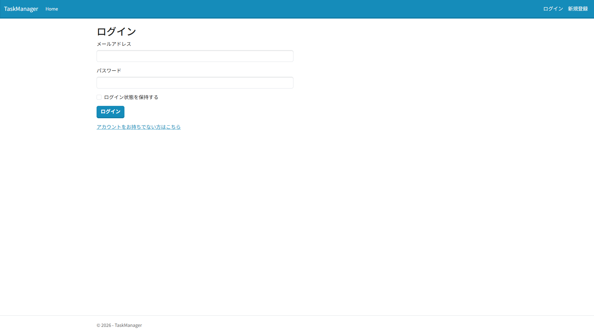
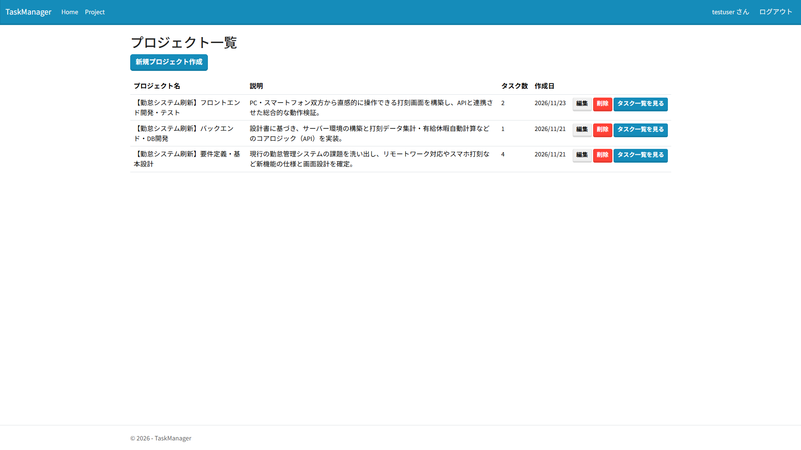
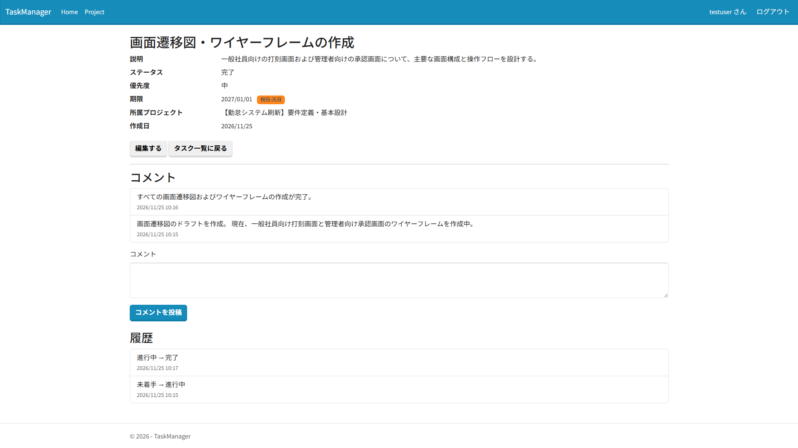

# TaskManager

ASP.NETCore MVCとPostgreSQLで作った、**個人用のタスク管理Webアプリ**です。  
C#による業務系・Web系開発の基礎を学ぶために、認証、DB設計、CRUD、外部API連携、WebAPI化までを一通り実装した**学習用ポートフォリオ**です。  
プロジェクトの下に複数のタスクをぶら下げ、ステータスや期限を管理できます。ユーザーごとにデータを分離しているので、自分のデータだけを閲覧・操作できます。  

<!-- TODO: 画面のスクリーンショットを docs/images に置いて、下の表を有効にする -->

## １．画面イメージ
| ログイン | プロジェクト一覧 |
|---|---|
|  |  |

| タスク一覧 | タスク詳細(コメント・履歴・祝日表示) |
|---|---|
|  |  |

| Swagger(Web API) |
|---|
|  |

---

## ２．主な機能
| 分類 | 内容 |
|---|---|
| 認証 | ユーザー登録、ログイン、ログアウト(ASP.NETCore Identity、Cookie認証) |
| プロジェクト管理 | 一覧、作成、編集、削除(削除時は紐づくタスクもまとめて削除) |
| タスク管理 | 一覧、作成、編集、削除、詳細表示 |
| ステータス変更 | 一覧画面のボタンで、未着手 → 進行中 → 完了と1クリックで進める |
| コメント | タスクごとのコメント投稿・一覧表示 |
| ステータス履歴 | ステータスが変わるたびに、変更前後と日時を自動記録・表示 |
| 祝日表示 | 外部APIから祝日を取得してDBに保存し、期限が祝日のタスクに祝日名を表示 |
| Web API | タスクのCRUDをRESTAPIとして提供(Swagger で確認可能) |

## ３．使用技術

- C# / .NET 10(ASP.NET Core MVC)
- Entity Framework Core 10 / Npgsql(PostgreSQL)
- ASP.NETCore Identity(Cookie認証)
- Razor / TagHelper / Bootstrap(BootswatchのLumen テーマ)
- Swashbuckle(Swagger UI)
- 外部 API:[Holidays JP API](https://holidays-jp.github.io/)(日本の祝日)

---

## ４．動作環境と起動方法
### 必要なもの

- .NET10 SDK
- PostgreSQL(動作確認は PostgreSQL18)
- VisualStudio2026
- 祝日の取得のため、起動時にインターネット接続が必要です(取得できなくてもアプリは起動します)

### 手順

1. リポジトリを取得し、`TaskManager.csproj` があるフォルダへ移動します。

   ```bash
   git clone https://github.com/kmz-0125/TaskManager.git
   cd TaskManager
   ```

2. DBの接続文字列を **User Secrets** に登録します(パスワードをリポジトリに含めないため)。

   ```bash
   dotnet user-secrets set "ConnectionStrings:DefaultConnection" "Host=localhost;Port=5432;Database=TaskManagerDb;Username=postgres;Password=<自分のパスワード>"
   ```

3. DBを作成します(マイグレーションを適用)。

   ```bash
   dotnet tool install --global dotnet-ef   # 未インストールの場合のみ
   dotnet ef database update
   ```

   VisualStudio の場合は、パッケージマネージャーコンソールで `Update-Database` でも構いません。

4. アプリを起動します。

   ```bash
   dotnet run
   ```

   起動後、表示されたURLにアクセスし、「新規登録」からユーザーを作成してください。

### Swagger(WebAPI)の確認

開発環境(`Development`)でのみ有効です。

1. 予め画面からログインします。
2. 同じブラウザで `/swagger` を開きます。
3. 未ログインのままAPIを呼ぶと、ログイン画面へのリダイレクトではなく `401` が返ります。

---

## ５．WebAPI
認証済み(ログイン済み)のユーザー自身のタスクだけを対象とします。

| メソッド | パス | 概要 | 主なレスポンス |
|---|---|---|---|
| GET | `/api/tasks` | 自分の全タスクを取得 | 200 |
| GET | `/api/tasks/{id}` | タスクを 1 件取得 | 200 / 404 |
| POST | `/api/tasks` | タスクを作成 | 200 / 400 / 404 |
| PUT | `/api/tasks/{id}` | タスクを更新(送った内容で置き換え) | 200 / 400 / 404 |
| DELETE | `/api/tasks/{id}` | タスクを削除 | 204 / 404 |

リクエスト例(`POST /api/tasks`):

```json
{
  "projectId": 1,
  "title": "資料を作成する",
  "description": "概要をまとめる",
  "status": "NotStarted",
  "priority": "Medium",
  "dueDate": "2026-10-01"
}
```

`status` は `NotStarted` / `InProgress` / `Completed`、`priority` は `Low` / `Medium` / `High` を文字列で指定します。

---

## ６．設計上の工夫
### 1. 他人のデータを操作させない(所有者チェック)
- 1件を取得する処理は、「IDが一致」かつ「所有者が自分」を1つのクエリで条件にしています。
- タスクはプロジェクト経由で所有者を判定します。表示(GET)だけでなく、更新・削除(POST)でも毎回所有者チェックをやり直しています。
- 所有者のIDはフォームから受け取らず、必ずログイン情報から取得します。

### 2. Modelと画面(ViewModel)・API(DTO)の分離
- DBに対応するModelを、画面やAPIのレスポンスにそのまま使わず、画面用は「ViewModel」API用は「DTO」に分けています。
- 入力に不要な項目を外部から受け取らない構造にしています。(ユーザーID、作成日時など)

### 3. 認証は「仕組みを理解してから標準ライブラリへ」
- 最初にBCryptとCookie認証(Claimの組み立て)で自前実装し、ハッシュ化・ソルト・認証Cookieの仕組みを学習しました。その後、ASP.NETCore Identityに移行しました。
- Identityのエラーメッセージは、`IdentityErrorDescriber` を継承して日本語化しています。

### 4. 外部API連携の設計
- 祝日は変わらないデータなので、一度取得したらDBに保存し、2回目以降の起動ではAPIを呼びません(キャッシュ)。
- 外部APIは失敗するものとして設計し、取得に失敗してもアプリ本体は起動します(ログに警告を残します)。

### 5. 日時はUTCで保存し、表示時に日本時間へ変換
- DBにはUTCで保存し、画面表示のときだけJSTに変換する拡張メソッドを用意しています。
- フォームから受け取った日付は `DateTimeKind` が不定になりPostgreSQLに保存できないため、保存前にUTCとして扱うよう揃えています。

### 6. ステータス履歴を1回の保存でまとめて記録
- ステータスの変更と、履歴の追加を、1回の `SaveChangesAsync()` でまとめて保存します。
- 「変更だけ反映されて履歴が残らない」といった中途半端な状態を防ぎます。

### 7. その他
- 共通処理(Enumの日本語表示、日時変換)は拡張メソッドにまとめ、重複を避けています。
- 画面のフォームは `[ValidateAntiForgeryToken]` でCSRF対策をしています。
- 接続文字列などの秘密情報はUser Secretsで管理し、リポジトリに含めていません。

---
## ７．開発の進め方について
> このアプリは、C#によるWeb開発を学ぶ目的で、**AIアシスタント(Claude)の解説・コード例・レビューを受けながら**作成しました。
- 機能は 1 つずつ区切って実装し、エラーの原因の切り分けや、設計の理由の確認にAIを使いました。
- 提示されたコードをそのまま使うだけでなく、自分で書いて修正したうえで、動作確認をしています。
